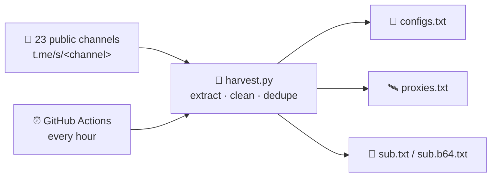

<div align="center">

# 🌾 SubHarvest

**Fresh V2Ray configs & MTProto proxies, harvested from public Telegram channels — automatically, every hour.**


[📥 Subscription](#-subscription-links) · [⚙️ How it works](#️-how-it-works) · [🛠 Customize](#-customize) · [💻 Run locally](#-run-locally)

</div>

---

## ✨ What is this?

Public Telegram channels post hundreds of free V2Ray configs and MTProto proxies every day — buried inside posts, mixed with ads and duplicates. **SubHarvest** reads the public preview of each channel, extracts every config and proxy link, removes duplicates, and republishes them as clean, ready-to-import files.

No account, no bot, no server: the whole pipeline runs on **GitHub Actions** and refreshes itself **every hour**.

## 📥 Subscription links

Import these URLs directly into your client (v2rayNG, Streisand, Nekoray, Hiddify, PattNG, …):

| File | Link |
|---|---|
| 🔗 Subscription (plain) | `https://raw.githubusercontent.com/Ashollii/SubHarvest/main/output/sub.txt` |
| 🔗 Subscription (base64) | `https://raw.githubusercontent.com/Ashollii/SubHarvest/main/output/sub.b64.txt` |
| 📄 All configs | `https://raw.githubusercontent.com/Ashollii/SubHarvest/main/output/configs.txt` |
| 🛰 All proxies | `https://raw.githubusercontent.com/Ashollii/SubHarvest/main/output/proxies.txt` |
| 📊 Harvest stats | `https://raw.githubusercontent.com/Ashollii/SubHarvest/main/output/stats.json` |

## ⚙️ How it works



- **Extract** — every `vless://`, `vmess://`, `trojan://`, `ss://`, `ssr://`, `hy2://`, `hysteria(2)://`, `tuic://`, `wireguard://` URI and every `t.me/proxy` link in the latest posts.
- **Clean** — HTML entities unescaped, trailing punctuation stripped, `tg://proxy` links normalised to `https://t.me/proxy`.
- **Dedupe** — first occurrence wins; the same config posted by nine channels appears once.
- **Rename** — every config in the subscription is renamed to **`ASHKAN-<n> <flag> <IPv4|IPv6>`** (the flag comes from the config's original name, 🌐 when unknown) — the same naming as the main [SUB](https://github.com/Ashollii/SUB). `configs.txt` keeps the original names.
- **Publish** — plain + base64 subscription files with profile headers (`#profile-title: ASHKAN`, update interval, usage, support & info URLs) that modern clients render as a named subscription with refresh & support buttons.

The harvester is **pure Python stdlib** — no dependencies, and truncated downloads are resumed with HTTP `Range` requests, so it survives flaky networks.

## 🛠 Customize

Want your own channel list? Edit [`channels.txt`](channels.txt) — one username per line — and the next hourly run does the rest. Only channels with a **public preview** produce output.

## 💻 Run locally

```bash
git clone https://github.com/Ashollii/SubHarvest
cd SubHarvest
python3 harvest.py        # writes output/ — that's it
```

Going through a proxy? Set it first:

```bash
SUBHARVEST_PROXY=http://127.0.0.1:3128 python3 harvest.py
```

## ⚠️ Disclaimer

Configs and proxies are collected from publicly posted material and belong to their original publishers. Availability and safety are not guaranteed — use at your own discretion.

<div align="center">

Made by **[Ashkan](https://github.com/Ashollii)** · Sister project: **[Nerkh](https://github.com/Ashollii/Nerkh)** — live Iranian market rates

</div>
